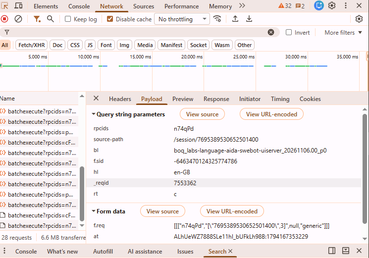

# JulesExportScript
Quirky way to say goodbye

# How to fill the memory script
1. Open an active jules session in a browser
2. Open your browser dev tools
3. Navigate to the network tab
4. Click on any batch request as seen in the attached screenshot, copy the cookies and the needed values (`at`, `f.sid`)
5. Fill them in and your are good to go.

### Didn't see the cookie ?
1. Click the Headers tab in the network pane and copy them, or
2. Right click on the request, select copy -> copy as (bash/cmd) then paste it somewhere and copy the `-b` value that's the cookie.

